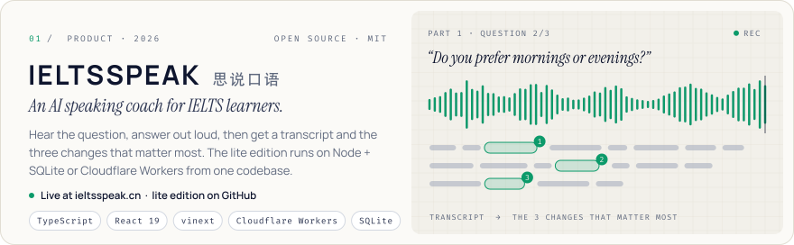
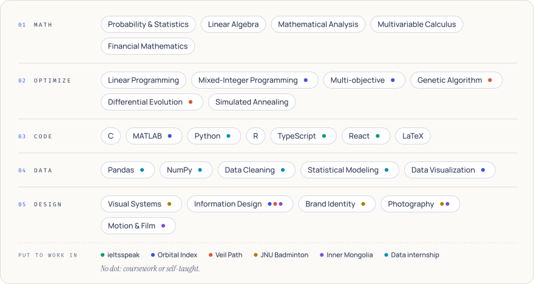

<!--
  github.com/Y1tong · profile README
  Everything in assets/ is generated: edit tools/build.py, then run `python tools/build.py`.
-->

<picture>
  <source media="(prefers-color-scheme: dark)" srcset="assets/header-dark.svg">
  
</picture>

<p align="center">
  <a href="https://zgh.netlify.app"><b>Portfolio</b></a> &nbsp;·&nbsp;
  <a href="https://zgh.netlify.app/zhang-guohao-cv.pdf"><b>CV</b></a> &nbsp;·&nbsp;
  <a href="https://ieltsspeak.cn"><b>ieltsspeak.cn</b></a> &nbsp;·&nbsp;
  <a href="mailto:2729930372@qq.com"><b>2729930372@qq.com</b></a> &nbsp;·&nbsp;
  Guangzhou / Shenzhen
</p>

### 0 · Abstract

I study **Mathematics & Applied Mathematics at Jinan University** (2024–2028) and work as a visual designer whose method is data, logic and systems. I've captained teams through 72- and 96-hour math-modeling marathons, built an AI speaking coach for IELTS learners, and designed visual systems for the things I care about. Design, to me, isn't decoration: it's how complex relationships get seen, understood and remembered.

**Keywords —** mathematical modeling · optimization (GA, DE, MILP) · information design · visual systems · TypeScript

<details>
<summary><b>中文摘要</b></summary>
<br>

我是张国皓，暨南大学数学与应用数学专业本科生，一名以数据、逻辑与系统为方法的视觉设计师，关注信息可视化、视觉系统与动态叙事。我带队拿过 CUMCM 广东省二等奖与 MCM/ICM S 奖，做了 AI 雅思口语练习网站「思说口语」，也为暨南大学羽毛球社重塑了品牌视觉。

以理性建立秩序，用视觉让复杂变得清晰。

</details>

### 1 · Objective

```math
\max_{x}\;\; \mathrm{clarity}(x)
\qquad \text{s.t.} \qquad
\mathrm{truth}(x) = \mathrm{truth}(\text{data}),
\quad |\text{team}| = 3,
\quad t \le 96\ \text{h}
```

<sub><i>Eq. (1) — make it clear, never at the cost of the truth, and ship before the deadline. MCM gives you 96 hours.</i></sub>

### 2 · Selected trajectories

<a href="https://github.com/Y1tong/ieltsspeak-lite"><picture><source media="(prefers-color-scheme: dark)" srcset="assets/card-ieltsspeak-dark.svg"></picture></a>

<!-- two cards per line at 50%, with nothing between them: the gutter is drawn into the SVGs -->
<div>
<a href="https://zgh.netlify.app/projects/orbital-index"><picture><source media="(prefers-color-scheme: dark)" srcset="assets/card-orbital-index-dark.svg"></picture></a><a href="https://zgh.netlify.app/projects/veil-path"><picture><source media="(prefers-color-scheme: dark)" srcset="assets/card-veil-path-dark.svg"></picture></a>
<a href="https://zgh.netlify.app/projects/jnu-badminton"><picture><source media="(prefers-color-scheme: dark)" srcset="assets/card-jnu-badminton-dark.svg"></picture></a><a href="https://zgh.netlify.app/projects/inner-mongolia"><picture><source media="(prefers-color-scheme: dark)" srcset="assets/card-inner-mongolia-dark.svg"></picture></a>
</div>

<sub>Try it at <a href="https://ieltsspeak.cn">ieltsspeak.cn</a> · code in <a href="https://github.com/Y1tong/ieltsspeak-lite">Y1tong/ieltsspeak-lite</a> · case studies 02–05 on <a href="https://zgh.netlify.app">zgh.netlify.app</a></sub>

### 3 · Toolkit

<picture>
  <source media="(prefers-color-scheme: dark)" srcset="assets/toolkit-dark.svg">
  
</picture>

### 4 · Convergence

<picture>
  <source media="(prefers-color-scheme: dark)" srcset="assets/convergence-dark.svg">
  
</picture>

<sub><i>Each faint dot is an attempt that never made the résumé. The line is the best-so-far.</i></sub>

<br><br>

<picture>
  <source media="(prefers-color-scheme: dark)" srcset="assets/footer-dark.svg">
  
</picture>
